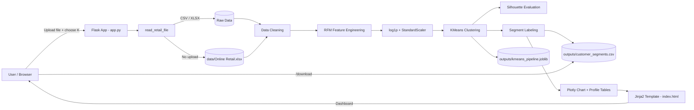
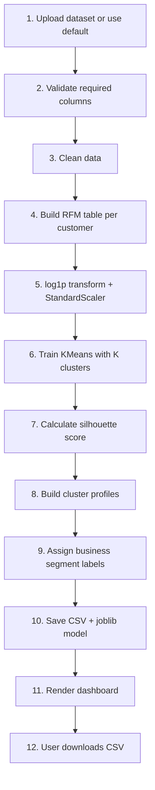

# Retail Customer Intelligence System

A Flask web application that segments retail customers using **RFM analysis** (Recency, Frequency, Monetary) and **K-Means clustering**, built on the UCI *Online Retail* dataset.

Upload a transaction file (or use the default dataset), choose the number of clusters, and get an interactive dashboard with customer segments, cluster profiles, and a downloadable CSV.

---

## Features

- Upload CSV / XLSX / XLS, or fall back to `data/Online Retail.xlsx`
- Automatic data cleaning (cancellations, negative quantity/price, missing CustomerID)
- RFM feature engineering per customer
- Log transform + standardization to handle skewed data
- K-Means clustering (2–10 clusters) with silhouette score
- Business labels per cluster (High-value loyal, Needs re-engagement, etc.)
- Interactive Plotly scatter plot (Frequency vs Spend)
- Cluster profile table and customer-level preview
- Download full results as CSV
- Trained scaler + model saved with `joblib` for reuse

---

## Tech Stack

| Layer | Technology |
|---|---|
| Backend | Python, Flask |
| Data processing | Pandas, NumPy |
| Machine learning | scikit-learn (KMeans, StandardScaler, silhouette_score) |
| Visualization | Plotly Express |
| Frontend | HTML, CSS, Jinja2 templates |
| Model persistence | joblib |

---

## System Architecture



### Layers

1. **Presentation layer** – `templates/index.html` (form, KPI cards, chart, tables)
2. **Application layer** – `app.py` routes: `/` (analyze) and `/download` (CSV)
3. **Processing layer** – cleaning, RFM, scaling
4. **ML layer** – KMeans + silhouette score
5. **Storage layer** – `data/` (input), `outputs/` (CSV + model)

---

## Project Workflow



### Step-by-step

| Step | What happens |
|---|---|
| 1. Input | User uploads file, or app reads `data/Online Retail.xlsx` |
| 2. Validation | Required columns: `InvoiceNo, Quantity, InvoiceDate, UnitPrice, CustomerID` |
| 3. Cleaning | Remove nulls, cancelled invoices (start with `C`), `Quantity <= 0`, `UnitPrice <= 0` |
| 4. RFM | **Recency** = days since last purchase, **Frequency** = unique invoices, **Monetary** = sum(Quantity × UnitPrice) |
| 5. Scaling | `np.log1p` to reduce skew, then `StandardScaler` |
| 6. Clustering | `KMeans(n_clusters=K, n_init=10, random_state=42)` |
| 7. Evaluation | Silhouette score (higher = better separated clusters) |
| 8–9. Profiling | Cluster means compared to medians → segment label |
| 10. Persist | `customer_segments.csv`, `kmeans_pipeline.joblib` |
| 11. Display | KPI cards, Plotly chart, profile + preview tables |

---

## Folder Structure

```
Retail-Customer-Intelligence-System/
│
├── app.py
├── requirements.txt
├── README.md
├── .gitignore
│
├── templates/
│   └── index.html
│
├── data/
│   └── Online Retail.xlsx
│
└── outputs/
    ├── customer_segments.csv
    └── kmeans_pipeline.joblib
```

> Flask requires `index.html` to be inside the `templates/` folder.

---

## Installation & Run

```bash
# 1. Clone
git clone https://github.com/<your-username>/Retail-Customer-Intelligence-System.git
cd Retail-Customer-Intelligence-System

# 2. Virtual environment
python -m venv venv
venv\Scripts\activate        # Windows
# source venv/bin/activate   # Mac/Linux

# 3. Install dependencies
pip install -r requirements.txt

# 4. Add dataset
# Place "Online Retail.xlsx" inside the data/ folder

# 5. Run
python app.py
```

Open **http://127.0.0.1:5000**

### requirements.txt

```
flask
pandas
numpy
scikit-learn
plotly
joblib
openpyxl
```

---

## Segment Labels

| Segment | Meaning |
|---|---|
| High-value loyal | Frequent, high spend, recent buyers |
| Previously valuable | Frequent, high spend, but not recent |
| Needs re-engagement | Frequent buyers who have gone quiet |
| Recent / developing | Recent buyers with low frequency |
| Low-frequency / low-spend | Infrequent, low-value customers |

---

## Sample Results (2 clusters, UCI Online Retail)

| Metric | Value |
|---|---|
| Valid transaction rows | 397,884 |
| Identified customers | 4,338 |
| Total sales | £8,911,407.90 |
| Silhouette score | 0.433 |

---

## Known Issues & Fixes

**Cluster Profile table shows `0.00` for Recency / Frequency / Spend**

*Cause:* In `app.py` the profile table columns are renamed to `AvgRecency`, `AvgFrequency`, `AvgMonetary`, but `index.html` reads `Recency`, `Frequency`, `Monetary`, so the lookup falls back to `0`.

*Fix* in `templates/index.html`:

```html
<td>{{ "%.2f"|format(row.get('AvgRecency', 0)|float) }}</td>
<td>{{ "%.2f"|format(row.get('AvgFrequency', 0)|float) }}</td>
<td>{{ "%.2f"|format(row.get('AvgMonetary', 0)|float) }}</td>
```

**Customer 12346 labeled "High-value loyal" with Frequency = 1**
Labels are assigned per *cluster*, not per customer. With only 2 clusters, a single large purchase pulls the customer into the high-spend cluster. Use 4–5 clusters for more meaningful segments.

---

## Future Improvements

- Elbow method + auto-select best K
- Cluster centroid radar chart
- Segment-wise marketing recommendations
- CLV prediction
- Docker + deployment (Render / Railway)
- REST API for scoring new customers using the saved joblib model

---

## Dataset

[UCI Machine Learning Repository – Online Retail](https://archive.ics.uci.edu/dataset/352/online+retail)

## License

MIT
